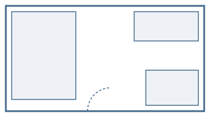

# 보고서 쓰는 법 예시

이 파일은 보고서 양식의 **사용 예시**예요. 그대로 복사해서 `reports/<이름>.md`로 저장한 뒤 내용을 바꿔 쓰면 돼요.
한글이 길게 이어지는 문장도 줄 끝에서 잘리지 않고 자연스럽게 다음 줄로 넘어가는지 확인하려고 일부러 긴 문장을 하나 넣어 두었어요.

## 1. 이번에 한 일

- 2D 평면도에서 가구를 끌어 옮기고 크기를 바꿀 수 있어요.
- 배치를 검사해서 **확실한 문제 / 개선 제안 / 좋은 점** 세 가지로 알려 줘요.
- 점수는 매기지 않아요. 무엇이 문제인지 글로 설명해요.
  - 벽이나 다른 가구에 딱 붙인 배치는 문제로 보지 않아요.

## 2. 확인한 결과

| 확인한 것 | 명령 | 결과 |
| :-- | :-- | :-- |
| 계산 검사 | `npm test` | 모두 통과 |
| 전체 빌드 | `npm run build` | 오류 0건 |
| 비밀값 검사 | `npm run check:dist` | API 키와 개인 경로 없음 |

> **알아 두세요**
> 통로 60cm는 참고값이에요 (법적·안전 기준 아님). 가격은 시연용 예상 가격이에요.



## 3. 실행 방법

```bash
npm install
npm run dev      # http://localhost:5180
```

1. 위 명령을 차례로 실행해요.
2. 브라우저에서 주소를 열고 [1초 예시 체험]을 눌러요.

## 4. 다음 할 일 3개

1. 3D 화면에서 걸어 다니는 보기 넣기
2. 시간대별 햇빛 넣기
3. 스케치업으로 내보내기(.dae) 넣기
